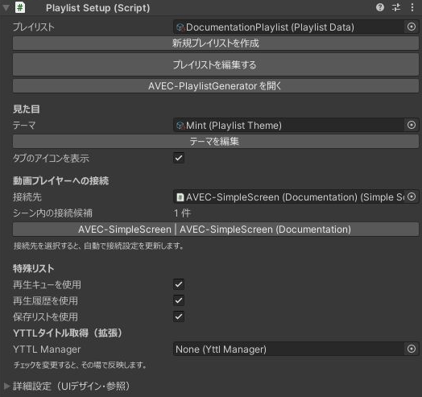
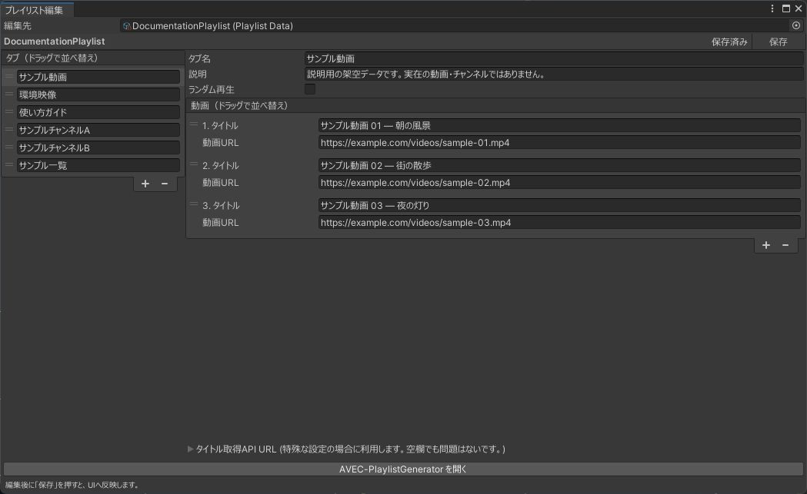

このページでは、通常の壁設置版を使い、動画を選んで再生できるように設定します。先に[インストール](installation.md)を済ませてください。

## 1. シーンに配置する

1. 使用する動画プレイヤーをシーンに配置します。
2. `Assets/aki_lua87/AVEC/Prefabs/AVEC-VideoPlaylist.prefab`をHierarchyへドラッグします。
3. 配置したプレイリストのルートを選び、Inspectorの **PlaylistSetup（以降「プレイリスト設定」）** を確認します。

タブレット版のプレイリスト設定は、子の **Playlist Screen** にあります。

## 2. プレイヤーへ接続する

プレイリスト設定で使用するプレイヤーと接続先を指定します。接続先はプレイヤーごとのコンポーネントです。見つからない場合は、本体と対応Connectorが両方導入されているか確認してください。

AVEC-SimpleScreenの場合は、シーンに配置したPrefabの **SimpleScreenPlayer** を指定します。追加Connectorは不要です。

*AVEC-SimpleScreenへ接続した設定例です。接続候補はシーン内のプレイヤーに応じて変わります。*

## 3. 動画を登録する

1. Inspectorの **新規プレイリストを作成** で、使用するPlaylistDataを作成します。
2. **プレイリストを編集する** を開きます。
3. タブを作り、動画のタイトルとURLを登録します。
4. 編集内容を保存します。

*左でタブを選び、右で動画を登録します。画像内の名前とURLはすべて撮影用のダミーです。`example.com`のURLは再生に使えません。編集後は右上の「保存」で反映します。*

同じPlaylistDataを複数のUIで共有できます。壁版とタブレット版に別の内容を表示したい場合は、それぞれに別のデータを作成します。

未設定のUIには共通のDefaultPlaylistが自動で割り当てられます。自分の一覧を使う場合は、上の手順で作成したPlaylistDataを指定してください。ワールド公開前に登録内容を確認してください。

## 4. 必要なリストを選ぶ

プレイリスト設定の **特殊リスト** で、再生キュー・再生履歴・保存リストの表示を個別に切り替えます。

設定は[キュー・履歴・保存リスト](../guides/queue-history-saved.md)にまとめています。

## 5. 保存して確認する

プレイリストデータとシーンを保存します。

VRChatへアップロードしたワールドで、動作確認してください。

表示を調整する場合は[見た目の設定](../guides/appearance.md)、手元で操作したい場合は[タブレット](../guides/tablet.md)・[リモコン](../guides/remote.md)へ進んでください。
