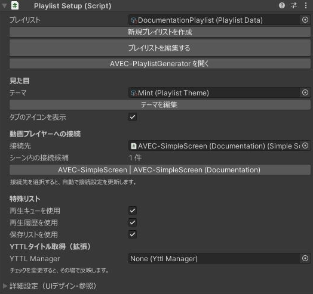
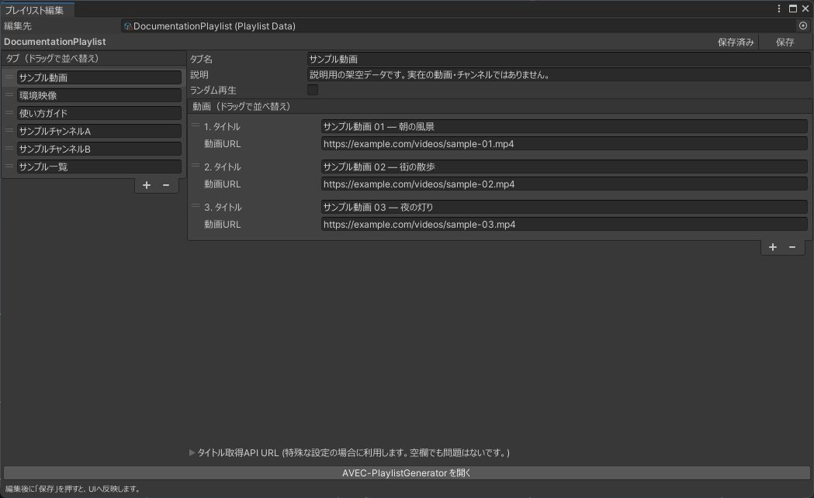

このページでは、通常の壁設置版を使い、動画を選んで再生できるように設定します。先に[インストール](installation.md)を済ませてください。

## 1. シーンに配置する

1. 使用する動画プレイヤーをシーンに配置します。
2. `Assets/aki_lua87/AVEC/Prefabs/AVEC-VideoPlaylist.prefab`をHierarchyへドラッグします。
3. 配置したプレイリストのルートを選び、Inspectorで **PlaylistSetup** を確認します。

タブレット版は子の **Playlist Screen** にPlaylistSetupがあります。

## 2. プレイヤーへ接続する

Setup Inspectorで使用するプレイヤーと接続先を指定します。接続先はプレイヤーごとのコンポーネントです。見つからない場合は、本体と対応Connectorが両方導入されているか確認してください。

AVEC-SimpleScreenの場合は、シーンに配置したPrefabの **SimpleScreenPlayer** を指定します。追加Connectorは不要です。

*撮影専用シーンでAVEC-SimpleScreenへ接続した設定例です。接続候補はシーン内のプレイヤーに応じて変わります。画像のテーマや、任意拡張のYTTL設定は必須ではありません。*

:::tip 既存のプレイヤーをそのまま使えます
使用中の動画プレイヤーを作り直す必要はありません。シーン上の接続はSetup Inspectorから行います。
:::

## 3. 動画を登録する

1. Inspectorの **新規プレイリストを作成** で、使用するPlaylistDataを作成します。
2. **プレイリストを編集する** を開きます。
3. タブを作り、動画のタイトルとURLを登録します。
4. 編集内容を保存します。

*左でタブを選び、右で動画を登録します。画像内の名前とURLはすべて撮影用のダミーです。`example.com`のURLは再生に使えません。編集後は右上の「保存」で反映します。*

同じPlaylistDataを複数のUIで共有できます。壁版とタブレット版に別の内容を表示したい場合は、それぞれに別のデータを作成します。

未設定のUIには共通のDefaultPlaylistが自動で割り当てられます。自分の一覧を使う場合は、上の手順で作成したPlaylistDataを指定してください。ワールド公開前に登録内容を確認してください。

## 4. 必要なリストを選ぶ

PlaylistSetupの **特殊リスト** で、再生キュー・再生履歴・保存リストの表示を個別に切り替えます。チェック変更はその場で反映されます。

設定の意味と利用者向けの操作は[キュー・履歴・保存リスト](../guides/queue-history-saved.md)にまとめています。

## 5. 保存して確認する

プレイリストデータとシーンを保存します。Unityでコンパイルエラーがないこと、接続先とPlaylistDataが設定されていることを確認します。

VRChatへアップロードしたワールドで、次を手動確認してください。

- タブと動画一覧が表示され、選択した動画が接続先で再生される。
- 再生／一時停止、次の動画、音量、ミュートを操作できる。
- 複数人での操作と途中参加が、プレイヤーの権限設定に従って動く。
- 保存リストを使う場合、退出・再訪後に自分のデータが復元する。

表示を調整する場合は[見た目の設定](../guides/appearance.md)、手元で操作したい場合は[タブレット](../guides/tablet.md)・[リモコン](../guides/remote.md)へ進んでください。
