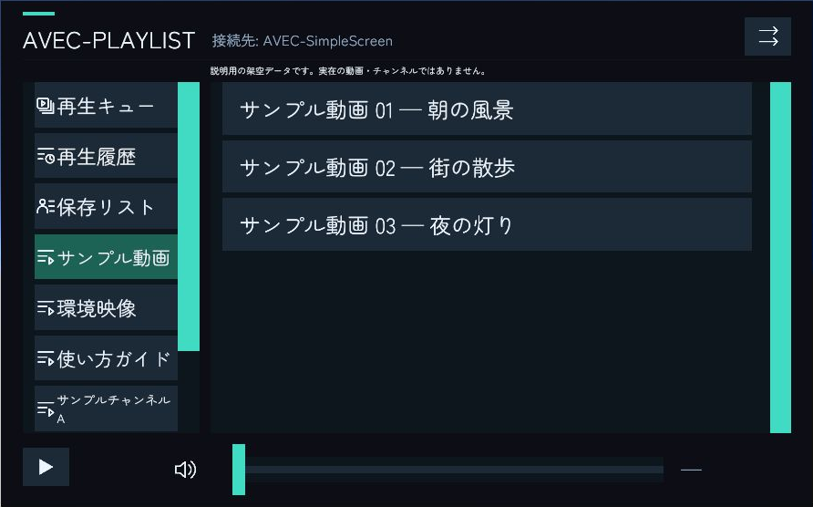

プレイリストは、動画をタブに分けて登録する機能です。ワールド作者がUnityで設定する動画一覧と、利用者が追加するキュー・保存リストは別のリストです。

*撮影専用シーンをUnity編集時に表示した例です。動画名・タブ名・URLは説明用のダミーで、実在の動画やチャンネルではありません。*

## 動画を選ぶ

タブから一覧を切り替え、動画を選んで詳細を開きます。動画詳細から再生や **キューへ追加** を行います。

タブの説明は1行表示です。長い説明は右端で切り、データ内の改行は表示時だけ空白へ置き換えます。元の説明データは保持されます。

## 再生順を選ぶ

順番再生、シャッフル、単曲リピートを使用できます。再生キューに動画がある場合は、プレイリストよりキューを優先します。

音量スライダーとスピーカーアイコンは、自分の音量とミュートだけを変更します。再生・一時停止などの操作は接続先の権限に従います。

## 動画一覧を編集する

PlaylistSetupの **プレイリストを編集する** からタブと動画を編集して保存します。専用データを作る場合は **新規プレイリストを作成** を使います。

同じPlaylistDataを指定したUIは同じ登録内容を使います。片方だけの内容を変えたいときは、先に別のPlaylistDataへ分けてください。

## コンパクト版

`AVEC-VideoPlaylistCompact.prefab`は画面が440×560で、通常版と同じ高さのまま横幅を抑えた版です。

上部のリスト選択を開くと、キュー・履歴・保存リスト・通常のリストを選べます。選択後、または外側を押すと閉じます。プレイリスト・テーマ・接続先の設定は通常版と共通です。

## タブのアイコン

PlaylistSetupの **タブのアイコンを表示** で切り替えます。

| 種類 | 表示するアイコン |
| --- | --- |
| 再生キュー | 再生マーク付きリスト |
| 再生履歴 | 時計 |
| 保存リスト | 人物 |
| 静的プレイリスト | リスト |
| 動的プレイリスト | 更新マーク付きリスト |

動的／静的はタイトル取得元URLの有無で判別します。アイコンをOFFにしても、タブ名や保存済みの動画データは変わりません。
