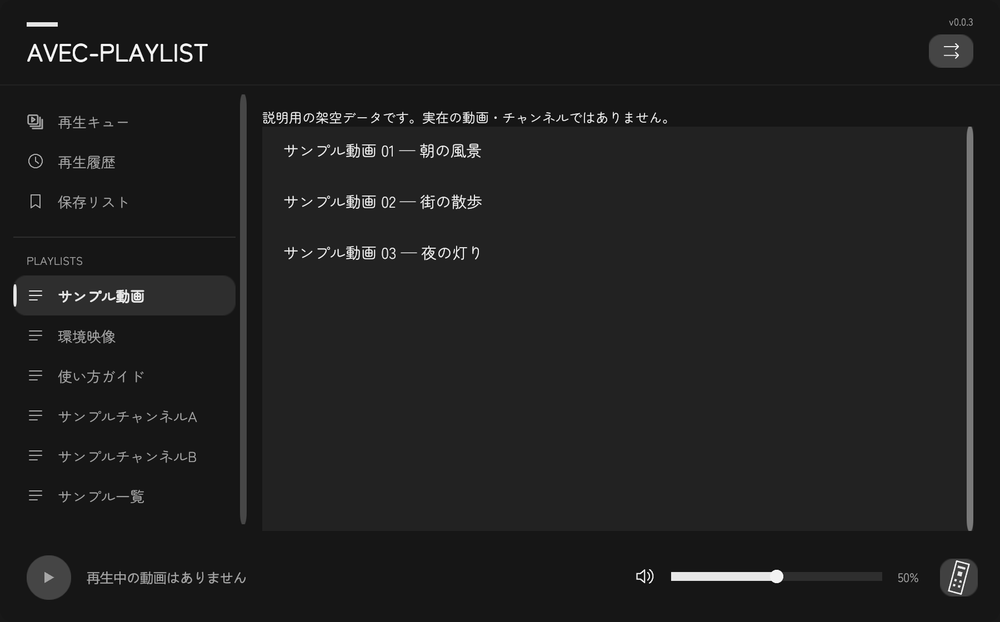

プレイリストは、動画をタブに分けて登録する機能です。

## 動画を選ぶ

タブから一覧を切り替え、動画を短く押して離すと直接再生します。

約0.6秒の長押しで動画詳細が開き、全文タイトル・URLの確認や **キューへ追加** を行えます。

一覧をドラッグした場合はスクロールします。

## 再生順を選ぶ

順番再生、シャッフル、単曲リピートを使用できます。再生キューに動画がある場合は、プレイリストよりキューを優先します。

## 動画一覧を編集する

プレイリスト設定の **プレイリストを編集する** からタブと動画を編集して保存します。専用データを作る場合は **新規プレイリストを作成** を使います。

同じPlaylistDataを指定したUIは同じ登録内容を使います。片方だけの内容を変えたいときは、先に別のPlaylistDataへ分けてください。

## コンパクト版

`AVEC-VideoPlaylistCompact.prefab`は画面が440×560で、通常版と同じ高さのまま横幅を抑えた版です。

上部のリスト選択を開くと、キュー・履歴・保存リスト・通常のリストを選べます。選択後、または外側を押すと閉じます。プレイリスト・テーマ・接続先の設定は通常版と共通です。

## タブのアイコン

プレイリスト設定の **タブのアイコンを表示** で切り替えます。

| 種類 | 表示するアイコン |
| --- | --- |
| 再生キュー | 再生アイコン |
| 再生履歴 | 時計アイコン |
| 保存リスト | ブックマークアイコン |
| 静的プレイリスト | リストアイコン |
| 動的プレイリスト | マーク付きリストアイコン |
