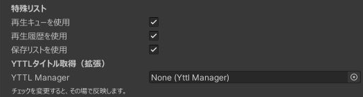

プレイリスト設定の **特殊リスト** で、それぞれを個別に有効にできます。チェック変更はその場で反映されます。

*3つのチェックで使用するリストを選びます。下のYTTL設定は任意拡張を導入した場合だけ表示されます。*

## 3つのリストの違い

| リスト | 目的 | 上限 |
| --- | --- | --- |
| 再生キュー | 次に再生したい動画を追加順に並べる。同期プレイヤーでは全員で共有 | 32件 |
| 再生履歴 | 再生した動画を見返す。同期プレイヤーでは全員で共有 | 32件 |
| 保存リスト | 自分のURLを保存して次回も使う。利用者ごとに独立 | 32件 |

## 再生キュー

動画詳細の **キューへ追加**、またはキューのURL入力から追加します。追加した順に再生し、通常のプレイリストより優先します。

**同期再生のプレイヤーでは、同じプレイヤーに接続したキューをインスタンス内の全員で共有**します。追加・削除・再生中の項目がほかの人にも反映され、壁のUIとタブレットからも同じキューを操作できます。別のプレイヤーに接続したキューとは共有しません。

プレイヤーをローカル再生モードで使う場合は、自分のキューだけを操作します。キューの追加・削除にも接続先プレイヤーの操作権限が適用されます。

- **次の動画へ** で次へ進みます。
- 各行の **×** でキューから削除します。
- 同期再生では、入力者名と動画タイトルも共有します。

## 再生履歴

行を選ぶと動画詳細を開けます。同じプレイヤーに接続した複数のUIでは、1つでも履歴が有効なUIがある間は記録します。

## 保存リスト

URLを入力して追加します。**追加だけでは再生を始めません。** 行を選ぶと動画詳細が開きます。詳細画面から再生や **キューへ追加** を行います。

登録項目を削除するには、動画詳細の **リストから削除** を押します。

URLは`http`／`https`で2048文字以内、重複URLは登録できません。全件を縦スクロールで表示します。リストへの登録・削除はプレイヤーの操作権限と独立していますが、再生要求には通常の権限が適用されます。

## 保存される範囲

保存先は **ユーザーアカウントごと・ワールドごと** です。同じワールド内の複数UIは自分のリストを共有し、別インスタンス・別端末でも同じワールドなら復元対象になります。復元完了までは編集できません。

画面には自分のデータを表示しますが、保存用の同期データは秘密情報の保管用途には使わないでください。

:::warning 公開後の保存データを維持するために
保存リストを保持するオブジェクトを削除・作り直したり、Network IDを変更したりしないでください。Hierarchy上では **CommonVideoPlaylist User Data** という名前です。これは現在のオブジェクト名で、通常は編集する必要はありません。既存の保存データとの対応が失われる場合があります。
:::

保存リストを無効にしても、保存用オブジェクトとデータは削除しません。PlayerObjectの保存枠は他アセットと共有の100KBで、このリスト自体にも48KBの推定上限があります。

共通プレイリストUIでは、入力エラー・権限不足・容量不足などのメッセージを画面に表示しません。項目が追加されない場合は、復元完了、URLの形式・重複、件数・保存容量を確認してください。

## タイトルを取得したい場合

基本機能にYTTLは不要です。[YTTLタイトル取得拡張](../extensions/yttl-titles.md)を追加すると、URLの追加時に再生せずタイトルを取得できます。取得できない場合はURLを表示して利用できます。

保存完了と退出・再訪後の復元は、アップロード済みワールドで手動確認してください。
