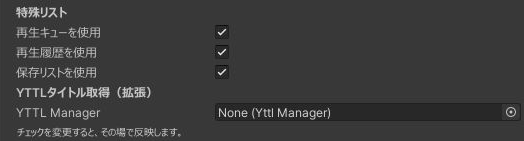
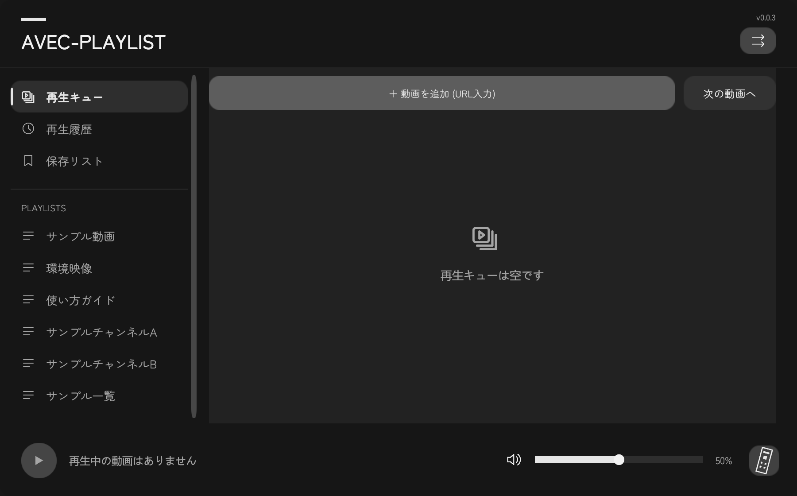

プレイリスト設定の **特殊リスト** で、それぞれを個別に有効にできます。

*YTTL設定は拡張を導入した場合だけ表示されます。*

## 3つのリストの違い

| リスト | 目的 | 上限 |
| --- | --- | --- |
| 再生キュー | 再生する動画をキュー形式で追加できます | 32件 |
| 再生履歴 | 再生した動画が保存されていきます | 32件 |
| 保存リスト | URLをワールドに保存できます | 32件 |

## 再生キュー

動画詳細の **キューへ追加**、またはキューのURL入力から追加します。追加した順に再生し、通常のプレイリストより優先します。

追加・削除・再生中の項目がほかの人にも反映され、壁のUIとタブレットからも同じキューを操作できます。

- **次の動画へ** で次へ進みます。
- 各行の **×** でキューから削除します。

## 再生履歴

行を選ぶと動画詳細を開けます。

## 保存リスト

URLを入力して追加します。**追加だけでは再生を始めません。** 行を選ぶと動画詳細が開きます。

詳細画面から再生や **キューへ追加** を行います。

登録項目を削除するには、動画詳細の **リストから削除** を押します。

重複URLは登録できません。

## 保存される範囲

保存先は **ユーザーアカウントごと・ワールドごと** です。同じワールド内の複数UIは自分のリストを共有し、別インスタンス・別端末でも同じワールドなら復元対象になります。復元完了までは編集できません。

:::warning 公開後の保存データを維持するために
保存リストを保持するオブジェクトを削除・作り直したり、Network IDを変更したりしないでください。Hierarchy上では **CommonVideoPlaylist User Data** という名前です。これは現在のオブジェクト名で、通常は編集する必要はありません。既存の保存データとの対応が失われる場合があります。
:::

保存リストを無効にしても、保存用オブジェクトとデータは削除しません。

## タイトルを取得したい場合

基本機能にYTTLは不要です。[YTTLタイトル取得拡張](../extensions/yttl-titles.md)を追加すると、URLの追加時に再生せずタイトルを取得できます。取得できない場合はURLを表示して利用できます。
