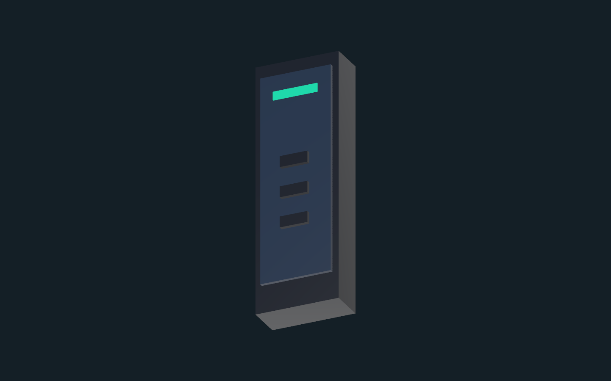
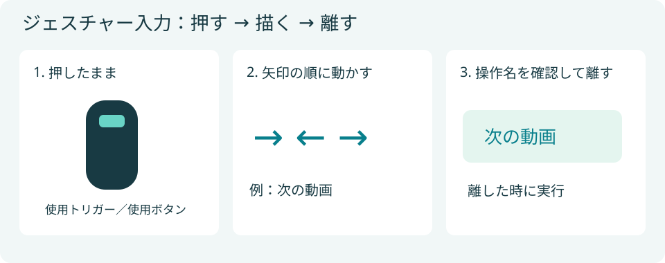
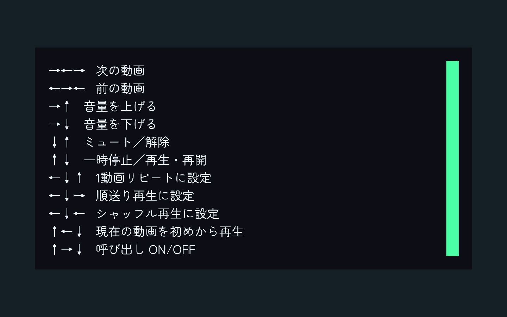
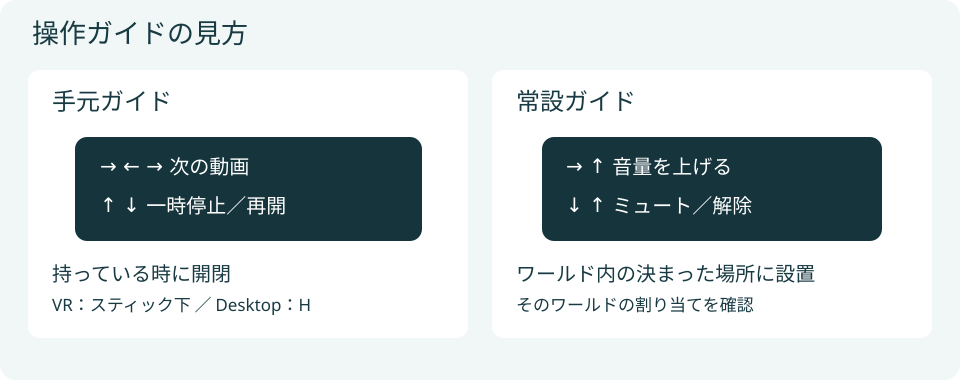

ジェスチャーリモコンは、接続先の動画プレイヤーを手元から操作するための機能です。

*Unityでの標準モデルの表示例です。*

## 配置と接続

1. `Assets/aki_lua87/AVEC/Prefabs/AVEC-GestureRemote.prefab`をシーンへ配置します。
2. ルートを選び、Inspectorの **リモコン設定（RemoteSetup）** で接続先プレイヤーを指定します。
3. プレイリストも操作する場合は、同じプレイヤーに接続したプレイリストを指定します。

プレイリストとの連携はCoreに同梱され、追加パッケージは不要です。**次の動画** はキューを優先します。

## ジェスチャーで操作する

*入力手順の説明図です。実際のワールド画面ではありません。*

1. リモコンを拾います。
2. **VRでは使用トリガーを押したまま**、リモコンの先を矢印の順に動かします。
3. 表示された操作名を確認してトリガーを離すと、操作を実行します。

Desktopではリモコンを持ち、**使用ボタン（通常はマウス左ボタン）を押したまま視線を動かし**、矢印の順を描いてから離します。VRChat側で入力を変更している場合は、その割り当てに従います。

### 初期の割り当て

矢印は自分から見た上下左右です。ひと続きに、左から順に描きます。

| ジェスチャー | 操作 |
| --- | --- |
| → ← → | 次の動画 |
| ← → ← | 前の動画 |
| → ↑ | 音量を上げる |
| → ↓ | 音量を下げる |
| ↓ ↑ | ミュート／解除 |
| ↑ ↓ | 一時停止／再生・再開 |
| ← ↓ ↑ | 1動画リピート |
| ← ↓ → | 順送り再生 |
| ← ↓ ← | シャッフル再生 |
| ↑ ← ↓ | 現在の動画を初めから再生 |
| ↑ → ↓ | リモコンの呼び出しをON／OFF |
| ↓ ← ↑ | 登録したタブレット・オブジェクトを呼び出す |

接続先プレイヤーや設置内容によって使えない操作があります。ワールド作者が割り当てを変えた場合は、ワールド内のガイドを確認してください。

## 操作ガイドと呼び出し

*Unityでの常設ガイドの表示例です。一覧はスクロールして確認できます。*

*手元ガイドと常設ガイドの違いを示す説明図です。*

操作ガイドには、そのリモコンに設定されたジェスチャーが表示されます。

| 状況 | 初期設定の操作 |
| --- | --- |
| VRでリモコンを持っている | 右スティックを下に倒して手元ガイドを開閉 |
| Desktopでリモコンを持っている | Hキーでガイドを開閉 |
| VRでリモコンを持っていない | 右スティックの下を1.5秒長押しして呼び出す |
| Desktopでリモコンを持っていない | 設置場所へ近づいて拾う。手元へ呼び出すキー操作はありません |

ガイドの開閉には長押し待機がありません。もう一度切り替えるには、スティックを戻すかHキーを離してから操作します。呼び出しの長押し時間は、リモコン設定の **詳細設定 > Summon Hold Seconds（呼び出しまでの秒数）** で変更できます。

常設の一覧を置く場合は`AVEC-GestureGuide.prefab`を配置し、リモコンと同じGestureDataを指定します。

## 呼び出し範囲を設定する

リモコン設定の **呼び出しを初期状態で有効にする** でON／OFFを選びます。

**呼び出し可能範囲（任意）** にBoxColliderを指定すると、プレイヤーの体の位置が範囲内にある時だけ呼び出せます。未設定の場合はどこからでも呼び出せます。

判定位置は足元からアバターの身長に応じて0.1〜0.75m上方です。床面に薄く置くのではなく、体の高さを含むBoxにしてください。

1. **呼び出し範囲を作成・接続** で、Trigger設定済みの範囲を作ります。`Assets/aki_lua87/AVEC/Features/Remote/Samples/AVEC-RemoteSummonArea.prefab`も利用できます。
2. BoxColliderの **Center／Size** とTransformで範囲を調整します。
3. 範囲はリモコンとは別の固定オブジェクトとして配置します。

リモコン自身やその子にある範囲、無効・非アクティブな範囲では呼び出せません。範囲を重ねると複数台が呼び出し対象になるため、複数台を置く場合は配置を確認してください。

範囲外へ出ると長押しの進行をキャンセルします。ガイド表示や通常のPickup操作には影響しません。

## プレイリストからON／OFFする

同じプレイヤーに接続したリモコンがある場合、プレイリスト右下にON／OFFボタンが表示されます。

各ユーザーのローカル切り替えです。OFFではリモコンが非表示になり、呼び出しもできません。ONに戻すと元の位置に表示します。同じ接続先の壁版とタブレット版は同じリモコンを切り替えます。

リモコンがない場合はボタンを表示しません。呼び出しだけのON／OFF設定とは別です。
