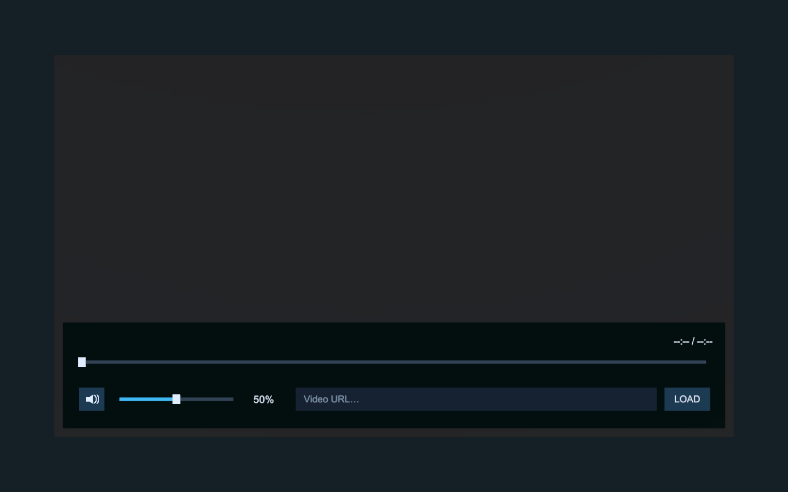
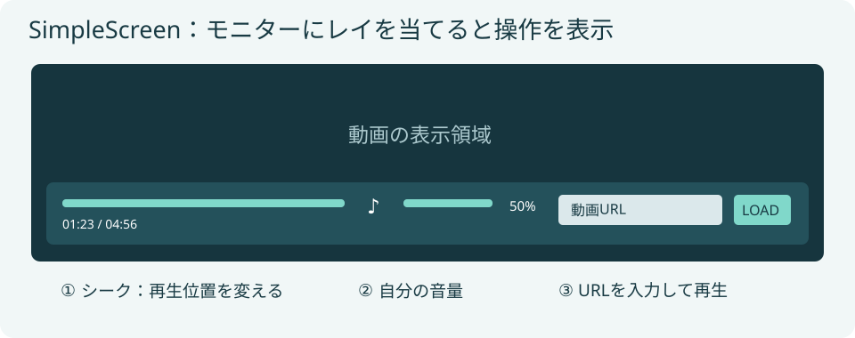

AVEC-SimpleScreenはCore同梱の独自プレイヤーです。VRChat SDKのAVPro再生コンポーネントを利用し、モニター、音源、最小限のUI、同期処理とPlaylist／Remote接続を含みます。

外部プレイヤーと追加Connectorは不要です。VRChat SDK自体は別途必要です。

*UnityでのPrefab表示例です。動画を読み込む前の状態です。*

## 配置する

1. `Assets/aki_lua87/AVEC/Prefabs/AVEC-SimpleScreen.prefab`をシーンへ配置します。
2. 必要なPlaylist／Remoteを配置します。
3. 各設定画面で、このPrefabの **SimpleScreenPlayer** を接続先に指定します。
4. ワールドにEventSystemがあることを確認します。

モニターの正面はローカル-Z側です。初期サイズは幅3.2m×高さ1.8mで、ルートの移動・回転・一様スケールで配置できます。

## モニターから操作する

*操作箇所を示す説明図です。実際のワールド画面ではありません。*

レイを当てると操作パネルが表示され、外して2秒後に非表示になります。ドラッグやURL入力中は表示を維持します。

| 操作 | 動作 |
| --- | --- |
| 進捗バーをドラッグして離す | シーク。ライブ配信や長さを取得できない動画では不可 |
| 音量バー・スピーカーアイコン | 自分の音量・ミュートを変更 |
| URL入力後に確定またはLOAD | 入力URLの再生へ切り替え |

URL入力はキューへの追加ではありません。直前のPlaylist連続再生を解除し、履歴に記録します。

再生・一時停止・停止・リピート・先頭から再生・Playlistの次／前などはPlaylist／Remote側から操作します。SimpleScreen独自の内部プレイリストはありません。

## 権限と同期

プレイヤー設定の **Master Only（再生操作の権限制限）** を有効にすると、再生操作をMasterまたはインスタンス所有者へ制限します。自分の音量・ミュートは引き続き変更できます。

URL、再生状態、時刻基準、単曲リピートなどを同期します。音量とパネルの表示状態は同期しません。途中参加や所有者交代の際も、受信した時刻基準を使って追従する設計です。

ライブ配信はURLと再生状態を共有しますが、配信側のバッファによる遅延差をシークで解消することはできません。

## エラーと再試行

読み込み中、権限不足、URLエラー、再試行状況はパネル上部に表示します。

一時的な失敗と読み込みタイムアウトでは再試行します。初期値は45秒のタイムアウト、5.5秒以上の再試行間隔、最大3回です。アクセス拒否・無効URLは自動再試行しません。上限後はURLを再送信してください。

エラーはローカル表示で、他の正常な視聴者の再生を停止しません。

## 調整と確認

初期音量、同期ずれの補正閾値、タイムアウト、再試行回数、パネルの表示待ち時間はInspectorから変更できます。音源の初期設定は3D／距離25m、解像度上限は1080です。

VRChatでの再生、複数人同期、途中参加、所有者退出、URLエラー、対象端末での映像・音声は別途手動確認してください。

PC／Androidの対応URL差やURL許可設定は、VRChatの再生仕様に従います。
