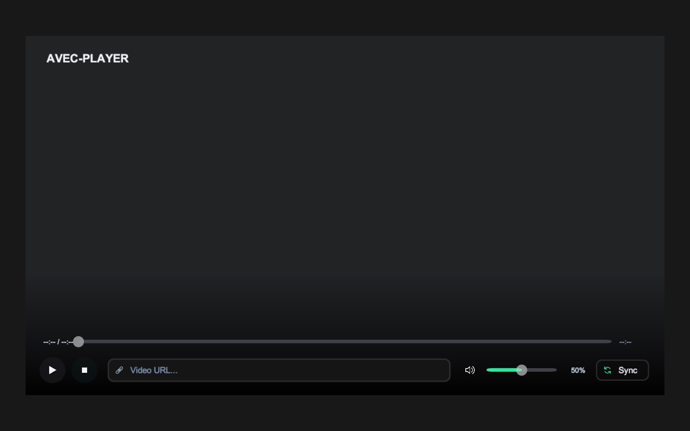

AVEC-SimpleScreenはCore同梱の独自プレイヤーです。AVProコンポーネントを利用し、モニター、音源、最小限のUI、同期処理とPlaylist／Remote接続を含みます。

外部プレイヤーと追加Connectorは不要です。

## 配置する

1. `Assets/aki_lua87/AVEC/Prefabs/AVEC-SimpleScreen.prefab`をシーンへ配置します。
2. 必要なPlaylist／Remoteを配置します。
3. 各設定画面で、このPrefabの **SimpleScreenPlayer** を接続先に指定します。
4. ワールドにEventSystemがあることを確認します。

モニターの正面はローカル-Z側です。初期サイズは幅3.2m×高さ1.8mで、ルートの移動・回転・一様スケールで配置できます。

## モニターから操作する

画面下1/3にレイを当てると操作UIを表示します。レイを外すとフェードアウトします。

動画名／URL表示は画面上部に配置しています。

| 操作 | 動作 |
| --- | --- |
| 再生／一時停止・停止ボタン | 接続先の操作権限に従って再生状態を変更 |
| Sync | 自分の再生位置を共有時刻へ合わせる。再生位置を取得できる動画で使用可能 |
| 進捗バーをドラッグして離す | シーク。ライブ配信や長さを取得できない動画では不可 |
| 音量バー・スピーカーアイコン | 自分の音量・ミュートを変更 |
| URLを入力して確定 | 入力URLの再生へ切り替え、入力欄をクリア |

URL入力はキューへの追加ではありません。

リピート・先頭から再生・Playlistの次／前などはPlaylist／Remote側から操作します。

## エラーと再試行

一時的な失敗と読み込みタイムアウトでは再試行します。初期値は45秒のタイムアウト、5.5秒以上の再試行間隔、最大3回です。アクセス拒否・無効URLは自動再試行しません。上限後はURLを再送信してください。

エラーはローカル表示で、他の正常な視聴者の再生を停止しません。

## 調整と確認

初期音量、同期ずれの補正閾値、タイムアウト、再試行回数はInspectorから変更できます。音源の初期設定は3D／距離25m、解像度上限は1080です。
