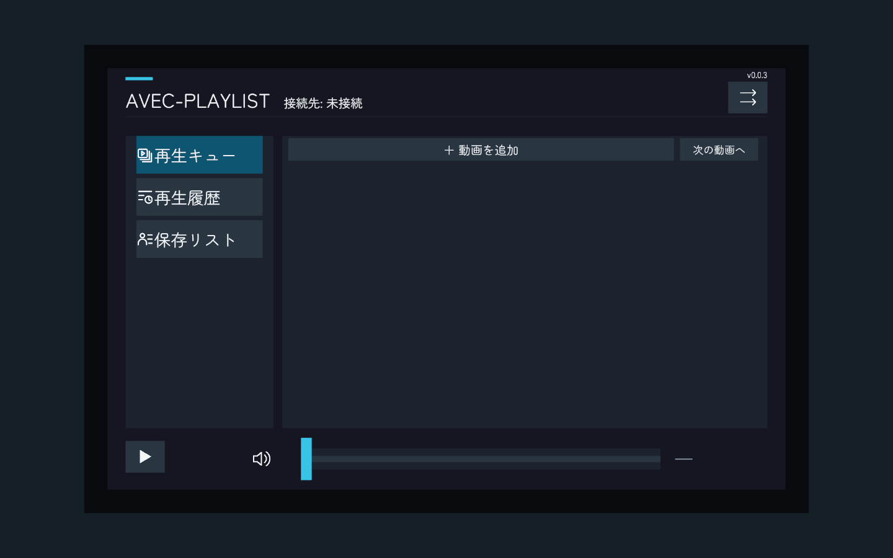
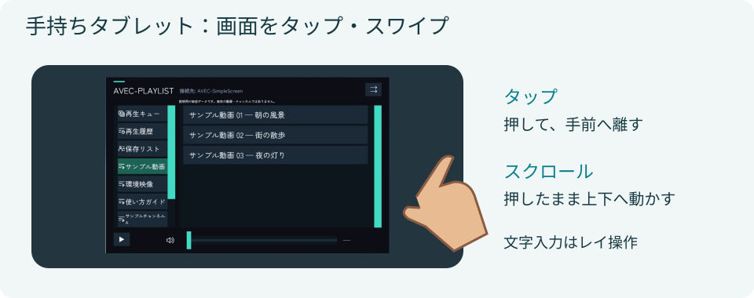

`AVEC-VideoPlaylistTablet.prefab`は、持ち運べるプレイリストです。通常のレイ操作に加え、VRでは人差し指によるタップとスクロールに対応します。

*UnityでのPrefab表示例です。プレイヤーや動画を設定する前の状態です。*

*操作の説明図です。画面部分には撮影用データを使った実UI画像を使用しています。外枠と指は説明用の図で、VRChat内の撮影画像ではありません。*

## 配置する

1. `Assets/aki_lua87/AVEC/Prefabs/AVEC-VideoPlaylistTablet.prefab`をシーンへ配置します。
2. 子の **Playlist Screen** を選びます。
3. プレイリスト設定でプレイリスト・テーマ・接続先を設定します。

画面幅は32cm、標準UIでは高さ約20cmです。外枠を含む幅は34.2cm、厚さは約6mmです。壁設置版とは別のオブジェクトなので、タブレットの設置場所と大きさはタブレット側で調整します。

## 持つ・放す

枠や背面をつかんで持ち運びます。VRでは握りを離すと手から放し、その位置に留まります。位置はユーザーごとのローカル扱いで、ObjectSyncは使いません。

同じプレイヤーに接続した壁版と、再生キュー・履歴を共有して使えます。

## 指で操作する

持っていない側の人差し指を画面へ押し込み、手前へ離すとボタンが反応します。押したまま上下に動かすと一覧をスクロールします。音量スライダーとスクロールバーも指で動かせます。

URL入力欄の選択・文字入力はレイ操作を使ってください。指ボーンのないアバターやDesktopでもレイ操作を使います。

## 指位置を調整する

ルートの **PlaylistTabletTouch** にある次の値を調整できます。距離の単位はメートルです。

| 項目 | 調整する内容 |
| --- | --- |
| Fingertip Extension | 推定する指先の延長 |
| Release Distance | 指を離したと判定する距離 |
| Maximum Penetration | 画面への押し込みの上限 |
| Drag Distance | ドラッグへ切り替わる距離 |

通常の導入では、指タッチの接続設定は不要です。ボタンのOnClickを自分で変更した場合に限り、指タッチ設定（PlaylistTabletTouch）のコンポーネントメニューから **Refresh Touch Bindings** を実行してください。

VRChatで、左右の持ち替え、指の位置、タップ・スワイプ、画面外の行への誤操作、Desktop操作を確認してください。
