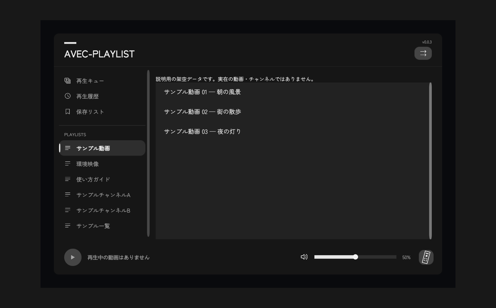

`AVEC-VideoPlaylistTablet.prefab`は、持ち運べるプレイリストです。通常のレイ操作に加え、VRでは人差し指によるタップとスクロールに対応します。

## 配置する

1. `Assets/aki_lua87/AVEC/Prefabs/AVEC-VideoPlaylistTablet.prefab`をシーンへ配置します。
2. 子の **Playlist Screen** を選びます。
3. プレイリスト設定でプレイリスト・テーマ・接続先を設定します。

## Pickup

位置はユーザーごとのローカル扱いで、ObjectSyncは使いません。

## 指で操作する

持っていない側の人差し指を画面へ押し込み、手前へ離すとボタンが反応します。

押したまま上下に動かすと一覧をスクロールします。音量スライダーとスクロールバーも指で動かせます。

通常のプレイリストの動画は短くタップすると直接再生し、約0.6秒触れ続けると動画詳細を開きます。

長押し後に指を離す操作は詳細表示として確定します。

指ボーンのないアバターやDesktopではレイ操作を使います。

## 指位置を調整する

ルートの **PlaylistTabletTouch** にある次の値を調整できます。距離の単位はメートルです。

| 項目 | 調整する内容 |
| --- | --- |
| Fingertip Extension | 推定する指先の延長 |
| Release Distance | 指を離したと判定する距離 |
| Maximum Penetration | 画面への押し込みの上限 |
| Drag Distance | ドラッグへ切り替わる距離 |

通常の導入では、指タッチの接続設定は不要です。ボタンのOnClickを自分で変更した場合に限り、指タッチ設定（PlaylistTabletTouch）のコンポーネントメニューから **Refresh Touch Bindings** を実行してください。
