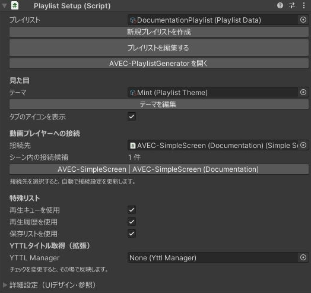

Unityで配置したオブジェクトを選び、Inspectorに表示される設定を使います。このサイトでは、**PlaylistSetupを「プレイリスト設定」**、**RemoteSetupを「リモコン設定」** と呼びます。

## プレイリスト設定（PlaylistSetup）

通常版・コンパクト版はルート、タブレット版・RTab版は子の **Playlist Screen** にあります。

*撮影専用シーンでAVEC-SimpleScreenへ接続した表示例です。プレイリストは撮影用のダミーデータです。接続候補と拡張の項目は、導入したアセットによって変わります。*

| 項目・操作 | 役割 |
| --- | --- |
| プレイリストデータ | タブと登録動画をまとめて保存するデータ |
| Theme Asset | プレイリストの配色・透明度を選ぶ |
| プレイヤー種別・接続先 | 使用するConnectorとシーン上のプレイヤー |
| 新規プレイリストを作成 | 専用のPlaylistDataを作成 |
| プレイリストを編集する | タブ・動画の編集画面を開く |
| タブのアイコンを表示 | タブの種類別アイコンを切り替え |
| 特殊リスト | キュー・履歴・保存リストを個別に有効化 |
| YTTLタイトル取得（拡張） | 拡張導入時のみ表示するManager接続 |

通常の導入では、上記以外の参照欄を変更する必要はありません。

## プレイリストデータ（PlaylistData）

ワールド作者が登録するタブと動画のデータです。複数UIで共有できます。[利用者の保存リスト](../guides/queue-history-saved.md)とは別です。

自分で作成したプレイリストデータは`Assets/AVECUserData/`などへ保存し、シーンと一緒にバックアップしてください。

## リモコン設定（RemoteSetup）

| 設定 | 役割 |
| --- | --- |
| 接続先プレイヤー | リモコンが操作するプレイヤー |
| プレイリスト | 同じプレイヤーに接続したプレイリストと連携する |
| GestureData | ジェスチャーの割り当て。操作ガイドにも同じ内容を使う |
| モデル設定 | リモコンの見た目の選択 |
| 呼び出しの初期状態・範囲 | 手元への呼び出し設定 |

常設ガイドにはリモコンと同じGestureDataを指定します。呼び出し範囲は[リモコンと操作ガイド](../guides/remote.md)を参照してください。

## 保存用オブジェクト

利用者ごとの保存リストを保持するオブジェクトです。Hierarchy上では **CommonVideoPlaylist User Data** という名前です。設定時に自動で用意され、同じシーンのUIで共有します。通常は個別に編集する必要はありません。

公開後の削除・再作成・Network ID変更は、保存データとの対応を失う可能性があります。詳細は[保存リスト](../guides/queue-history-saved.md)を参照してください。

## SimpleScreenと指タッチ

プレイヤー固有の調整は[AVEC-SimpleScreen](../guides/simple-screen.md)、指先判定は[手持ちタブレット](../guides/tablet.md)にまとめています。
